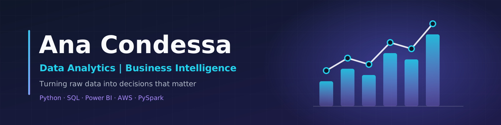

  

# Hi, I'm Ana Condessa 👋

### Data Analytics | Business Intelligence | Data-Driven Decision Making

I'm a business-oriented data professional with experience in customer success, project management, and performance analysis, currently specializing in **Data Analytics and Business Intelligence** through FIAP's Data Analytics postgraduate program.

I combine business understanding with hands-on experience in data analysis, visualization, and cloud-based data processing to transform raw data into actionable insights that support better decisions.

📍 Belo Horizonte, Brazil | Open to remote and international opportunities

---

## 🛠️ Technical Skills

**Data Analysis & Programming**

* Python, Pandas, NumPy
* SQL, Spark SQL
* Exploratory Data Analysis (EDA)
* Data cleaning, validation, and transformation

**Business Intelligence & Visualization**

* Power BI, DAX
* Excel
* Matplotlib
* KPI development, dashboard design, and analytical reporting

**Big Data & Cloud**

* Amazon S3
* AWS Glue
* Amazon Athena
* PySpark
* Data Lake architecture (Bronze, Silver, and Gold layers)

**Machine Learning**

* Scikit-learn
* Classification models
* Feature engineering and model evaluation

**Tools & Foundations**

* Jupyter Notebook
* Git and GitHub
* HTML5 and CSS3 fundamentals

---

## 🚀 Featured Projects

### 1. The Data & AI Market in Brazil

**FIAP Tech Challenge | Big Data Analytics**

An end-to-end data project exploring Brazil's data and AI job market using industry survey data.

* Built a cloud-based Data Lake with Bronze, Silver, and Gold layers.
* Worked with Amazon S3, AWS Glue, PySpark, Spark SQL, and Amazon Athena.
* Applied data transformation and exploratory analysis to support business-oriented insights.

🔗 [View Project on GitHub](https://github.com/apcondessa/Mercado_de_Dados_Brasil)

### 2. E-commerce Analytics — Olist

**FIAP Tech Challenge | Business Intelligence**

An analytical project focused on e-commerce performance, sales, and customer behavior.

* Analyzed sales, freight, delivery performance, and repeat purchases.
* Developed KPIs to evaluate revenue, customer retention, and regional performance.
* Used Python and Power BI to support data-driven business recommendations.

### 3. Wine Quality Classification

**Machine Learning | Python | Scikit-learn**

A machine learning project focused on predicting wine quality using classification techniques.

* Performed exploratory data analysis and feature engineering.
* Compared classification approaches and evaluated model performance.
* Achieved **85.42% accuracy with Random Forest** in the project evaluation.

🔎 [Explore my repositories](https://github.com/apcondessa?tab=repositories)

---

## 📊 Core Competencies

* Translating business questions into analytical problems
* Data cleaning, exploration, and quality validation
* KPI definition and performance monitoring
* Dashboard development and data storytelling
* Customer behavior and business performance analysis
* Structured problem-solving and cross-functional collaboration

---

## 🎯 Current Focus

* Advancing my skills in Data Analytics and Business Intelligence
* Building end-to-end analytics and Big Data projects
* Strengthening SQL, Python, Power BI, and cloud data processing
* Connecting data pipelines, analytical insights, and business decisions

🎓 **Postgraduate Program in Data Analytics — FIAP**

---

## 🤝 Let's Connect

I'm interested in opportunities where data, technology, and business strategy come together to solve real-world problems.

* 💼 [LinkedIn](https://www.linkedin.com/in/anapaulacondessa/)
* 📧 [Email](mailto:anacondessa001@gmail.com)
* 💻 [GitHub Repositories](https://github.com/apcondessa?tab=repositories)
