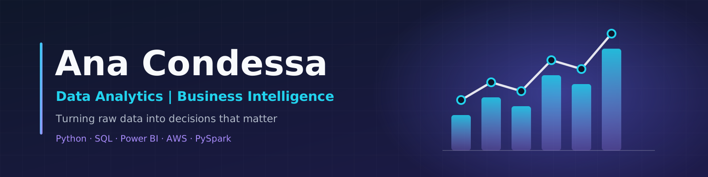

  

<h1 align="center">Hi, I'm Ana Condessa 👋</h1>

  <b>Junior Data Analyst · Data Analytics · Business Intelligence</b> 
  Python · SQL · Power BI · AWS · Machine Learning

  
  
  

---

## 💡 About Me

I'm a data analyst in career transition, bringing **10+ years of business, customer, and IT operations experience** into Data Analytics and BI.

Before data became my focus, I was already working with it every day: tracking KPIs in Customer Success, analyzing customer and product data to find patterns, improving onboarding flows, running CRM processes and satisfaction surveys, and monitoring distributed systems under SLA at **IBM**. What motivated me most was understanding *why* the numbers moved — so I decided to build the technical foundation to answer that question properly.

Today I'm studying in the **FIAP Data Analytics postgraduate program (2026–2027)** and continuously learning with **Alura**, applying everything in hands-on projects with Python, SQL, Power BI, and AWS.

📍 Belo Horizonte, Brazil · 🌎 Open to remote and international opportunities · 🗣️ Portuguese (native), English (fluent), Spanish (professional)

---

## 🚀 Featured Projects

### 📈 1. The Data & AI Market in Brazil — Cloud Data Lake
**FIAP Tech Challenge · Big Data Analytics**

An end-to-end data project exploring Brazil's data and AI job market using industry survey data.

- Designed a cloud **Data Lake with Bronze, Silver, and Gold layers** (medallion architecture)
- Built the pipeline with **Amazon S3, AWS Glue, PySpark, and Spark SQL**, and queried curated data with **Amazon Athena**
- Cleaned, transformed, and explored the data to answer business questions about the market

`AWS S3` `AWS Glue` `PySpark` `Spark SQL` `Athena`

🔗 [View project](https://github.com/apcondessa/Mercado_de_Dados_Brasil)

### 🛒 2. E-commerce Analytics — Olist
**FIAP Tech Challenge · Business Intelligence**

A business-oriented analysis of a Brazilian e-commerce marketplace.

- Processed **112,000+ sales records**: data cleaning, transformation, and exploratory analysis
- Built KPIs for **revenue, average ticket, repeat purchases, freight, delivery performance, and regional results**
- Created **Power BI dashboards** and translated the findings into recommendations on customer behavior and regional performance

`Python` `Pandas` `Power BI` `DAX`

### 🍷 3. Wine Quality Classification
**Machine Learning · Python**

A classification model to predict wine quality from physicochemical attributes.

- Performed EDA, feature engineering, and data preparation
- Compared classification algorithms and evaluated their performance
- Reached **85.42% accuracy with Random Forest** and explained the results in business terms

`Python` `Pandas` `Scikit-learn` `Random Forest`

### 🏆 Hackathons & Innovation Projects
Before moving into data, I joined innovation programs such as **Gama Academy, Startup Weekend, Mega Hack Women, and Hackathon Zenvia (Shawee)**:

- **Mais Tempo** (2020) — **Top 10** at Hackathon Zenvia; smarter automated customer service flows to reduce user waiting time · [Demo](https://youtu.be/emarbbyWSdQ)
- **DevPrev** (2020) — health-sector solution for the Mega Hack Women Vital Challenge · [Demo](https://www.youtube.com/watch?v=6En18QaK048)
- **Super Lucro & Propagou Eventos** (2019) — Gama Academy growth projects focused on generating pre-qualified leads

🔎 [Explore all my repositories](https://github.com/apcondessa?tab=repositories)

---

## 🎓 Education & Continuous Learning

| Program | Focus |
|---|---|
| 🎓 **FIAP** — Postgraduate in Data Analytics (Pós-Tech) · **2026–2027** | Python, SQL, Power BI, Big Data on AWS, Machine Learning, and business-oriented analysis through Tech Challenge projects |
| 📚 **Alura** — Ongoing studies in Data & Analytics | Including *Classification with Machine Learning*; continuous practice in Python, data analysis, and BI |
| 🎓 **FGV** — Postgraduate in Business Administration (2016–2017) | Business strategy, management, and decision-making |
| 🚀 **Gama Academy** — Growth Hacking (2019) | Metrics, experimentation, and lead generation |
| 💻 **Centro Universitário Una** — Computer Networks Technology (2009–2011) | IT and infrastructure foundations |

---

## 💼 Experience That Supports My Data Work

- **Customer Success & Onboarding** (Zapper, Duotalk, Jivo, Platzi) — analyzed customer and operations data to find patterns and improvements, tracked adoption indicators, and redesigned onboarding flows to shorten integration and activation cycles
- **CRM & Marketing** (VMI Security, V4 Company, Obabox, Stockholm Precision Tools) — managed CRM data and satisfaction surveys, tracked campaign performance (Google/Meta Ads), and monitored KPIs, pricing, and marketplaces
- **IT Operations at IBM** — led a team monitoring distributed systems under SLA, handled problem and change management, and served as SME on a global project across Brazil, the US, and Argentina

This background lets me connect analysis to real business context: I know which questions stakeholders ask and how to communicate answers clearly.

---

## 🛠️ Tech Stack

**Data Analysis & Programming** 

**Business Intelligence & Visualization** 

**Big Data & Cloud** 

**Machine Learning** 

**Tools** 

---

## 📊 What I Bring

- Translating business questions into analytical problems
- Data cleaning, exploration, and quality validation
- KPI definition and performance monitoring
- Dashboard development and data storytelling
- Customer behavior and operations analysis
- Clear communication with stakeholders in Portuguese, English, and Spanish

---

## 🎯 Current Focus

- Completing the **FIAP Data Analytics** program (2026–2027) and its Tech Challenge projects
- Deepening **SQL** (window functions, data modeling) and advanced **DAX** through Alura and FIAP
- Building more end-to-end projects, from data pipeline to dashboard to business recommendation
- Looking for a **Junior Data Analyst / BI Analyst** role

---

## 🤝 Let's Connect

I'm interested in teams where data, technology, and business strategy come together to solve real problems.

💼 [LinkedIn](https://www.linkedin.com/in/anapaulacondessa/) · 📧 [anacondessa001@gmail.com](mailto:anacondessa001@gmail.com) · 💻 [GitHub](https://github.com/apcondessa?tab=repositories)
